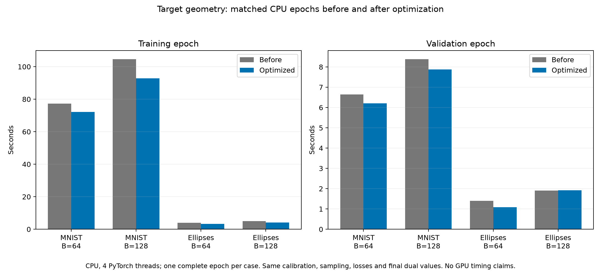

# Target geometry performance audit — 1 November 2026

Profiled the actual MNIST and ellipse source checkpoints and cached target datasets, comparing Git revision `775c21b` with the optimized working tree. Device: CPU on macOS arm64; 4 PyTorch threads; PyTorch 2.12.1, Python 3.12.3. CUDA and MPS were unavailable in this session.

Each case used its complete target training and validation splits, VAE batch size 128, geometry B=64 or 128, 128 source calibration batches and 64 validation geometry batches. Stage timings used 5 warm-up steps and 40 measured steps; the epoch table is one complete matched epoch, not an average or confidence interval. Seed 42, eta=100, dual rate=0.01; source checkpoint models, likelihood/KL, optimizer and sampling settings were unchanged.

## Measured results

| Dataset | Geometry B | Training before | Training after | Training time saved | Validation before | Validation after |
| --- | ---: | ---: | ---: | ---: | ---: | ---: |
| mnist | 64 | 77.330 s | 72.241 s | 6.6% | 6.642 s | 6.212 s |
| mnist | 128 | 104.619 s | 92.815 s | 11.3% | 8.383 s | 7.874 s |
| ellipsis | 64 | 4.029 s | 3.280 s | 18.6% | 1.402 s | 1.082 s |
| ellipsis | 128 | 5.034 s | 4.121 s | 18.1% | 1.903 s | 1.926 s |



The improvement is in training; validation is not uniformly faster. Ellipse B=128 validation changed from 1.903 to 1.926 seconds (about 1.2% slower in this single observation). One sample does not establish a small validation improvement or regression. Calibration time also has no consistent improvement. These measurements do not establish CUDA, MPS, multi-worker throughput or remote-filesystem performance.

## Bottlenecks and changes

1. **Convolution forward/backward dominates.** In the original MNIST B=64 operator trace, convolution backward accounts for about 63% of total profiled CPU time; convolution forward accounts for most of the remainder. Sampling, Gram arithmetic and Adam are smaller. The maximum usually gives one view zero gradient, yet the old graph still ran backward through that losing decoder. The trainer now routes the gradient through the strictly winning view, releases the losing diagnostic graph, and retains the original equal-share `Tensor.max` gradient at exact ties. Both view values are still evaluated and checked. The VAE gradient still reaches the adapted decoder, preserving Adam/momentum behavior.

2. **Zero multipliers built an unused gradient graph.** When lambda is exactly zero, both views still contribute diagnostics and the same dual update, but their geometry graph is no longer built. This is an execution optimization for an identically zero contribution, not removal of a mathematical view.

3. **Repeated host reads serialize accelerators.** The original finite/nondegeneracy checks and per-value logging performed many separate host reads. The two views now share one checked input Gram energy, their output checks are combined, and the scalar loss/components/distortions are copied together. In a normal full-view step with the default two VAE components, explicit scalar synchronization points fall from 15 to 3. CPU effects are small; GPU speedups from this change remain unmeasured. Checks and numerical guards were retained.

4. **Geometry image assembly used Python item loops.** Ordinary tensor datasets and nested subsets now gather from their existing image tensor using the exact original randperm indices. No image copy cache, transform bypass or new sampling rule is introduced. Generic/custom datasets retain item-by-item access. Target sampling in this run improved as follows:

| Dataset | B | Before | After |
| --- | ---: | ---: | ---: |
| mnist | 64 | 0.608 ms | 0.392 ms |
| mnist | 128 | 0.562 ms | 0.514 ms |
| ellipsis | 64 | 0.252 ms | 0.051 ms |
| ellipsis | 128 | 0.368 ms | 0.057 ms |

Full precision, the independent target geometry sampler, source tolerance, source-decoder gradient path, maximum/expectation placement, eta, dual rule, epochs, calibration/validation counts and ordinary VAE objective were retained. The original regularizer, core VAE, LoRA layers, original trainer, FID/scoring and ablation configurations are untouched. The dominant remaining costs are the convolution forwards and backwards required by the VAE and two-view geometry; no unverified precision or backend switch was made.

## Numerical audit

All four complete epoch comparisons had **exactly equal** training losses, validation losses, calibrated source tolerances and final dual values. A separate audit started both versions from the actual checkpoints, coupled the VAE noise and sample sequences, and compared after 5 optimizer steps per dataset/B pair:

| Dataset | B | Max parameter difference | Max gradient difference | Max Adam-state difference | Loss difference |
| --- | ---: | ---: | ---: | ---: | ---: |
| mnist | 64 | 0 | 0 | 0 | 0 |
| mnist | 128 | 0 | 0 | 0 | 0 |
| ellipsis | 64 | 0 | 0 | 0 | 0 |
| ellipsis | 128 | 0 | 0 | 0 | 0 |

Calibrated tolerance, dual state and geometry sampler RNG state also matched exactly. Unit regression tests additionally cover full/target-only/source-only views, each possible winning view, exact ties, zero and nonzero initial multipliers, partial VAE batches, nested subsets, custom transforms, and repeated Adam momentum updates. The unit equivalence tolerance is 1e-13 in float64. This validates the tested trajectories; it is not an optimization-convergence claim.

## Local I/O check

Separately measured five checkpoint-plus-sidecar saves and five batches of 30 TensorBoard scalar writes plus flushes. Image logging includes the existing two 36-image generation grids and 16 input/reconstruction pairs. This check used a stateful Adam model on a local temporary filesystem; it is not a remote-storage benchmark.

| Dataset | Checkpoint + sidecar (median) | 30 scalars + flush (median) | Images + flush (one event) |
| --- | ---: | ---: | ---: |
| mnist | 6.52 ms | 1.09 ms | 35.60 ms |
| ellipsis | 2.88 ms | 1.32 ms | 16.59 ms |

Local logging and checkpoint writes were minor compared with the measured epochs. Images are normally logged at epoch 1 and every 20 epochs, so this cost does not occur every step. Main epoch timings exclude logging, checkpoint saves, FID and result figures.

## Reproduce and inspect

From the repository root:

```bash
python scripts/profile_target_geometry.py --reference-ref 775c21b --device cpu --threads 4 --steps 40 --epochs 1 --output /tmp/target_geometry_profile
python scripts/profile_target_geometry.py --reference-ref 775c21b --audit-only --audit-steps 5 --output /tmp/target_geometry_equivalence
```

Raw data: [timings.json](timings.json), [summary.csv](summary.csv), [equivalence.json](equivalence.json), [io.json](io.json). Operator tables:

- mnist, B=64: [reference](reference_mnist_B64_operators.txt), [current](current_mnist_B64_operators.txt).
- mnist, B=128: [reference](reference_mnist_B128_operators.txt), [current](current_mnist_B128_operators.txt).
- ellipsis, B=64: [reference](reference_ellipsis_B64_operators.txt), [current](current_ellipsis_B64_operators.txt).
- ellipsis, B=128: [reference](reference_ellipsis_B128_operators.txt), [current](current_ellipsis_B128_operators.txt).
